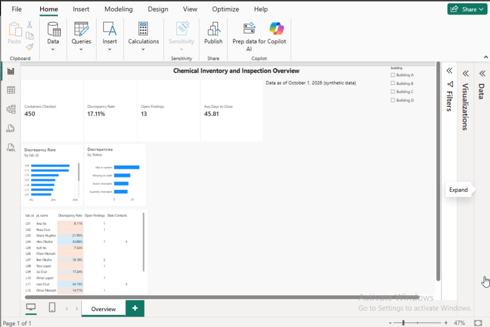
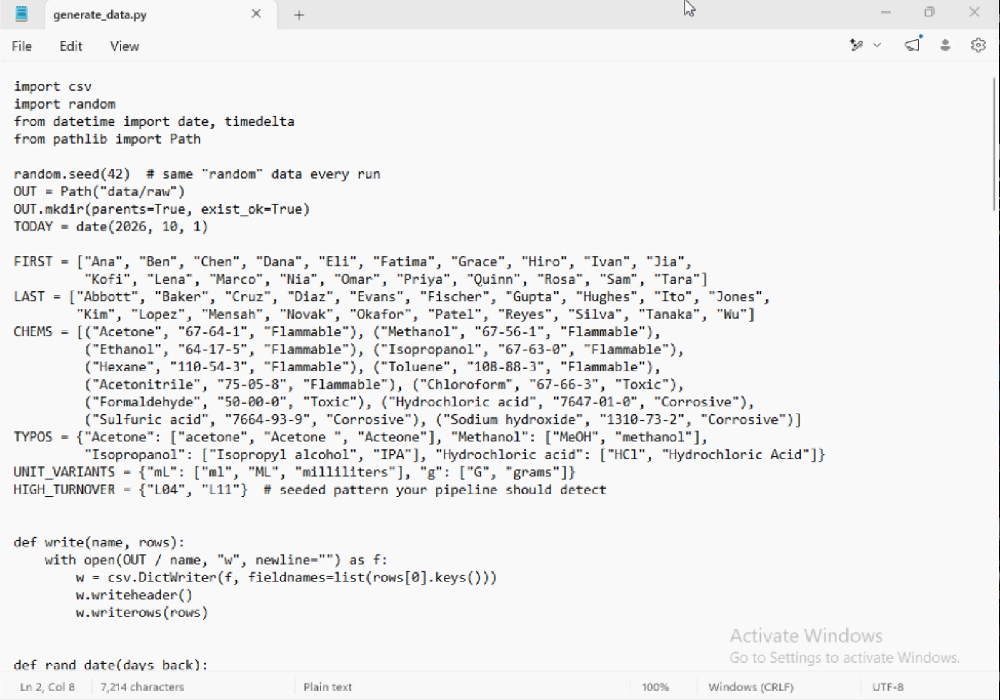
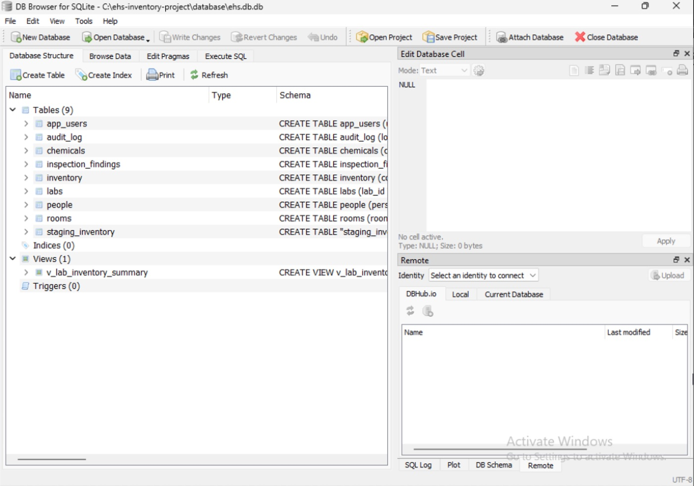
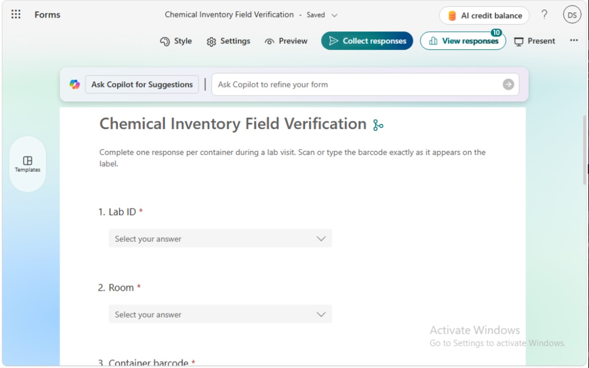
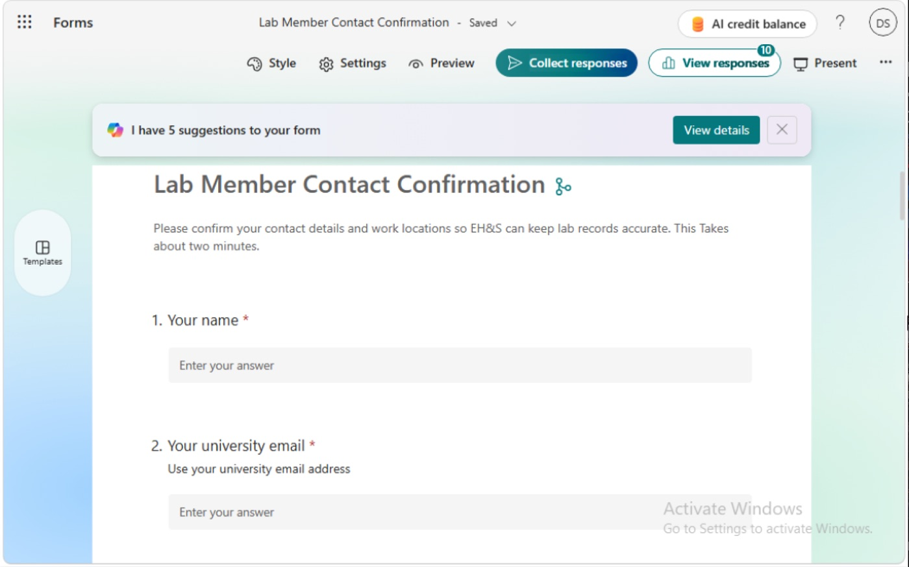
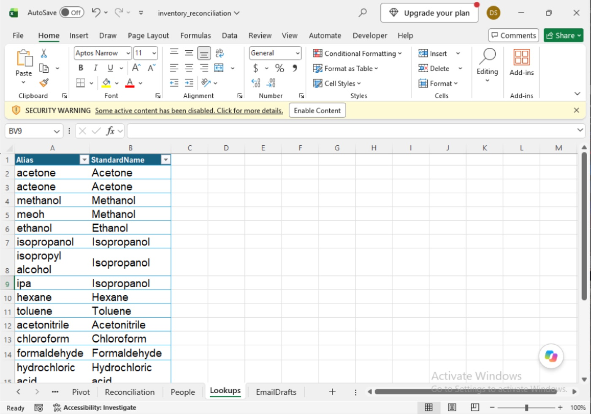
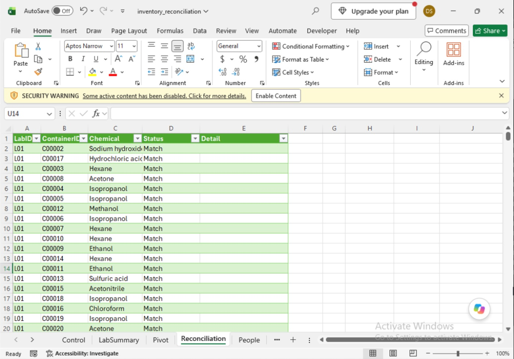
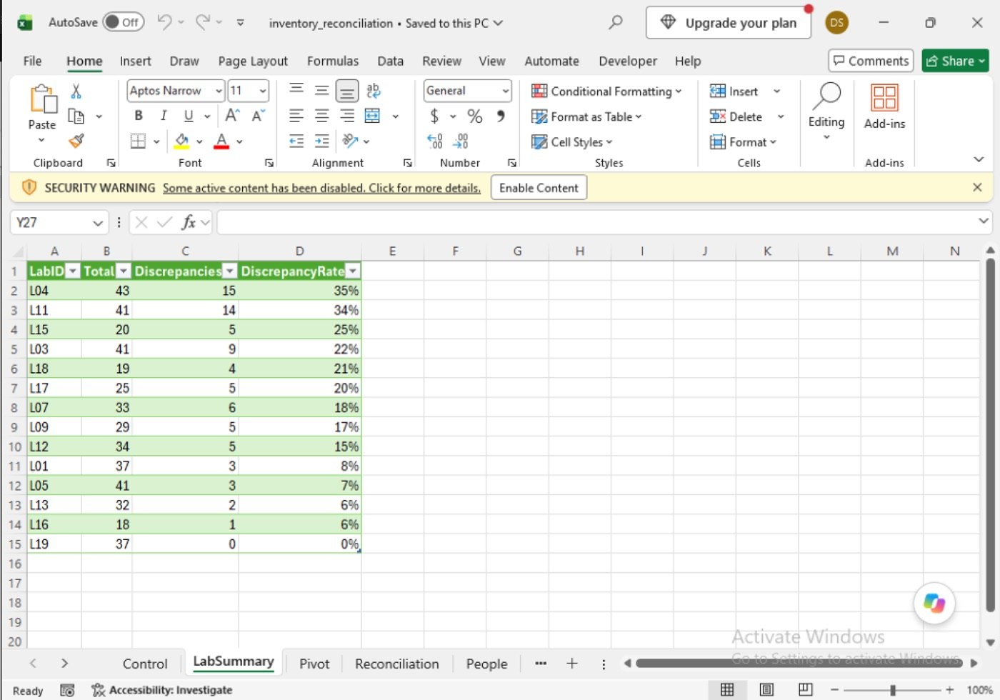
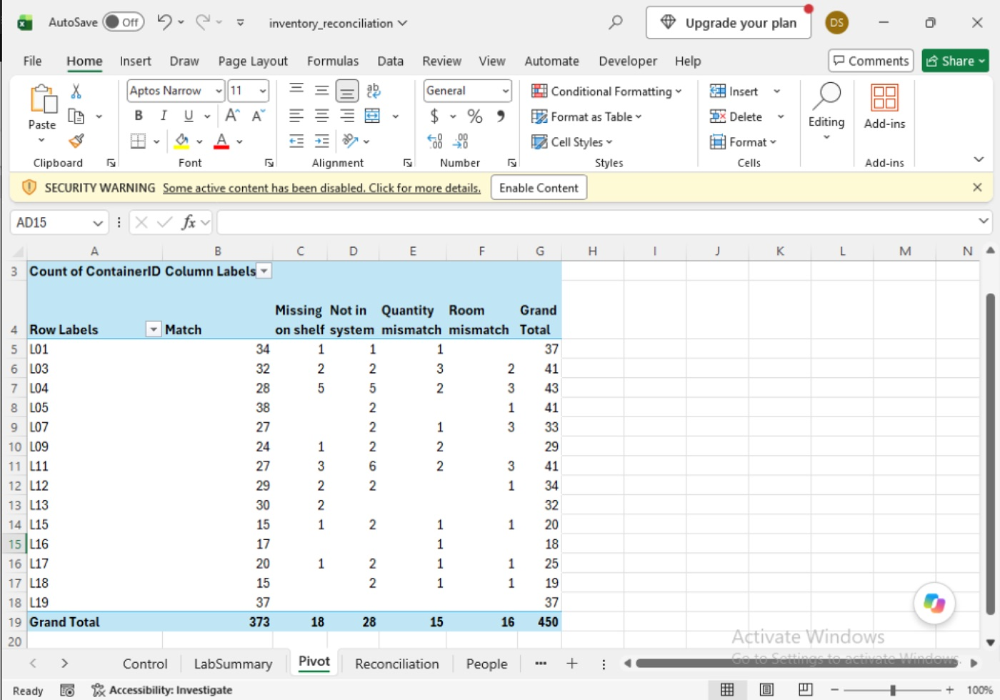
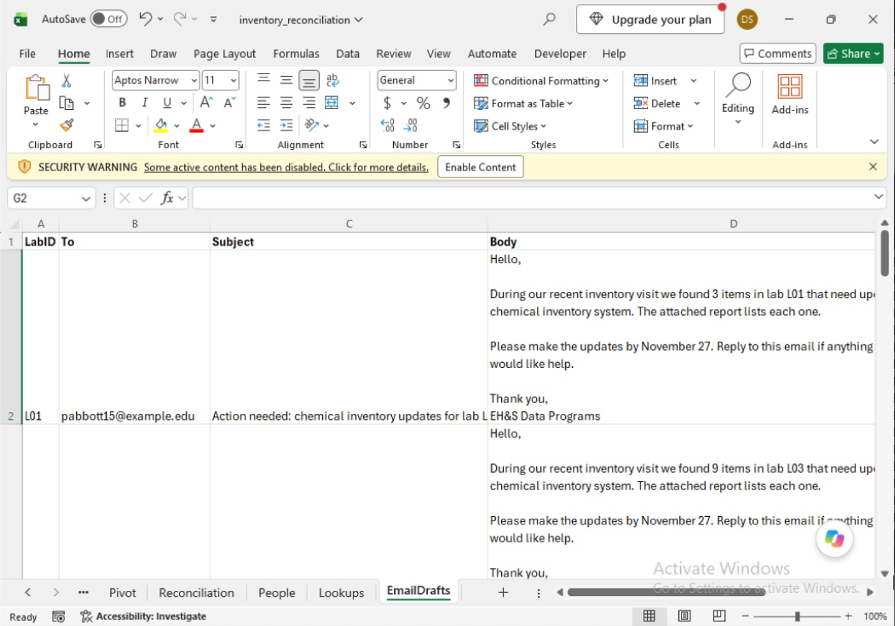

# Chemical Inventory Reconciliation

An end-to-end data analysis project on a university Environmental Health & Safety (EH&S) chemical inventory. A system export is reconciled, container by container, against field checks of 14 labs. Every container is labeled a match or one of four discrepancy types, and the results feed per-lab reports, reminder email drafts, and a Power BI dashboard.

> **All data is synthetic.** A Python script generates it, with messy records and one deliberately seeded pattern (high turnover in labs L04 and L11) so the analysis can be checked against a known answer.

**Finding:** two of the 14 visited labs, L04 and L11, hold 19% of the containers checked but 38% of all inventory discrepancies. Each has a discrepancy rate above one in three, versus 13% across the other 12 labs, and together they account for every out-of-date contact record.



## What it covers

| Stage | Tool | What it does |
| --- | --- | --- |
| Synthetic data | Python | `generate_data.py` writes seven CSV files with seed 42, so every run is identical |
| Database | SQLite (DB Browser) | Schema, data-quality checks, cleaning, account and audit-log practice, backup and restore |
| Data collection | Microsoft Forms | A field verification survey and a lab contact confirmation survey |
| Reconciliation | Excel and Power Query | Cleans the export, merges it with the field data, labels every discrepancy, summarizes by lab |
| Follow-up automation | VBA | One report workbook and one reminder email draft per lab with issues, run in one click |
| Reporting | Power BI and DAX | One-page dashboard with six measures |
| Scheduling | Power Automate | Monthly reminder flow, designed on paper but not built (see below) |

## The data model

Seven tables for four buildings and 20 labs: `labs`, `rooms`, `people`, `chemicals`, `inventory_system_export`, `field_verification`, and `inspection_findings`.

Two design decisions drive the rest of the project:

- **The CAS number identifies a chemical.** Names are typed by hand and drift ("IPA", "Isopropyl alcohol", "Isopropanol"). A CAS number identifies exactly one chemical, so the cleaned inventory stores the number and looks the name up from the `chemicals` table.
- **The container barcode is the reconciliation key.** It is what you scan on the shelf, so it is how a field record matches a system record.

`generate_data.py` injects the problems a real export would have: name variants, missing CAS numbers, inconsistent units, mixed date formats, duplicate records, and field discrepancies (missing from the shelf, wrong room, partly used up, or on the shelf but never entered).



## Cleaning in SQLite

The messy export is loaded into an unconstrained staging table, checked, and then cleaned into the real `inventory` table. The checks in [`sql/02_data_quality_checks.sql`](sql/02_data_quality_checks.sql) found:

| Check | Result |
| --- | --- |
| Duplicate container records | 16 container IDs appear twice |
| Missing CAS numbers | 12 rows |
| Unit spellings | 7 spellings of 2 units (g, mL, G, grams, ml, milliliters, ML) |
| Names that disagree with the CAS reference list | 32 rows (for example "MeOH" or "Acteone") |
| Contacts not confirmed in over a year | 6 people, all in L04 and L11 (3 each) |

One statement ([`sql/03_clean_inventory.sql`](sql/03_clean_inventory.sql)) removes the duplicates, blanks empty CAS numbers, standardizes units, and converts MM/DD/YYYY dates, taking 580 system records down to 564.

[`sql/04_admin_tasks.sql`](sql/04_admin_tasks.sql) practices account creation, a value update, deactivating stale accounts, and a saved status view, each logged to an `audit_log` table. SQLite has no built-in logins, so the `app_users` table models how an application manages roles. The database was also backed up, deliberately broken, and restored to prove the backup works.



## Surveys

Two Microsoft Forms surveys support data collection. The generated field file stands in for many completed visits, so each form was piloted with 10 test responses.

- **Field Verification** is filled in during a lab visit, one response per container. Lab and room are drop-downs, quantity accepts numbers only, unit is a fixed choice, and "Not found" skips the quantity question.
- **Lab Contact Confirmation** is filled in by lab members to keep rosters current, and branches to a "who has left?" question only when someone has.

Closed questions wherever possible keep the data clean, but Forms cannot check formats such as a barcode pattern, which is why the Power Query cleanup still matters.





## Reconciliation in Power Query

The pipeline in `inventory_reconciliation.xlsm` is built from queries whose custom-column formulas are collected in [`power_query/formulas.m`](power_query/formulas.m):

1. **System** cleans the export (trims text, parses both date formats with a US locale, removes duplicates, standardizes units) and looks up each chemical's standard name, first by CAS number and then through the alias table below.
2. **Field** and **VisitedLabs** load the field data and the 14 labs that were visited.
3. **SystemVisited** keeps only system rows for visited labs (422 rows). Without this filter, every container in the six unvisited labs would show as missing from the shelf, which is the classic reconciliation mistake.
4. **Reconciliation** does a Full Outer merge of `SystemVisited` and `Field` on container ID (450 rows) and adds a `Status` column:

```
if [container_id] = null then "Not in system"
else if [Field.container_id] = null then "Missing on shelf"
else if [room_id] <> [Field.room_id] then "Room mismatch"
else if [quantity] <> [Field.quantity] then "Quantity mismatch"
else "Match"
```

5. **LabSummary** groups by lab for the discrepancy rate. Refresh All reruns the whole pipeline on new data.









## Follow-up automation in VBA

[`vba/InventoryAutomation.bas`](vba/InventoryAutomation.bas) holds three macros:

- `CreateLabReports` saves one discrepancy workbook per lab with issues.
- `DraftReminderEmails` writes one reminder per lab to an `EmailDrafts` sheet, addressed to the lab manager, or flagged `NO LAB MANAGER ON FILE` when there is none.
- `RunMonthlyCycle` refreshes the data and runs both, from one button.

The macros write drafts to a sheet instead of sending anything, so a person reviews every message before it goes out. Table and sheet names are the contract between Power Query and VBA: renaming `Reconciliation` or `People` breaks the macros.



## Dashboard in Power BI

A single page titled "Chemical Inventory and Inspection Overview" shows four cards (containers checked, discrepancy rate, open findings, average days to close), a discrepancy rate by lab, discrepancies by status, a lab table with conditional formatting, and a building slicer. The model is a star schema with `Labs` in the middle and `Reconciliation`, `Findings`, and `People` around it. The measures are in [`dax/measures.dax`](dax/measures.dax).

One bug worth knowing about: a first version of the `Discrepancies` measure showed the same total on every bar of the status chart, including Match, because its own filter replaced the chart's Status filter. Wrapping the condition in `KEEPFILTERS` fixed it, and the chart then showed the correct counts.

## Findings

Full write-up: [`docs/findings-summary.pdf`](docs/findings-summary.pdf).

- **17.11% of containers checked had a discrepancy** (77 of 450). L04 (15 of 43, 35%) and L11 (14 of 41, 34%) lead, and L19 had none (0 of 37).
- **The most common problem is containers on the shelf that were never entered** (28 of 77), followed by containers listed but not found (18), found in the wrong room (16), and wrong quantity (15). The system undercounts what is actually stored.
- **The export needed significant cleanup before it could be trusted:** 16 duplicates, 12 missing CAS numbers, 7 unit spellings, and 32 names that did not match their CAS number.
- **13 inspection findings were open**, and closed findings took 45.8 days on average.

## Recommendations

1. **Visit high-turnover labs first.** Labs with stale contact records also had the most discrepancies, so contact age is a cheap early-warning signal.
2. **Confirm lab rosters every six months** with the contact survey, so reminders reach someone who can act on them.
3. **Require a CAS number and a fixed unit list at data entry**, so names and units cannot drift.
4. **Schedule the six unvisited labs** so every lab is verified at least once.

## Power Automate (designed, not built)

A monthly flow would read the `EmailDrafts` table, send each lab manager their reminder with the report attached, and email EH&S a summary listing labs with no manager on file and any failed sends. Building it needs a Microsoft work or school account, which this project did not have, so the full specification is in [`docs/power-automate-flow-design.md`](docs/power-automate-flow-design.md): steps, error handling, least-privilege and governance notes, and a test plan.

## Run it yourself

The project was built on Windows 11. You need Python 3, DB Browser for SQLite, Excel for Windows (Power Query and VBA), and Power BI Desktop.

1. Run `python generate_data.py`. It prints `580 system rows, 432 field rows` and writes seven CSV files to `data/raw`.
2. Create the database with `sql/01_schema.sql`, import the CSV files (the system export into a table named `staging_inventory`), then run the checks and cleaning statement.
3. Build the Power Query connections and paste in the formulas from `power_query/formulas.m`.
4. Import `vba/InventoryAutomation.bas` into the workbook (Alt+F11, then File, Import File) and save as `.xlsm`.
5. Load the workbook and CSV files into Power BI, relate `Labs[lab_id]` to the other three tables, and add the measures.

Keep the project in a plain local folder, not OneDrive, so `ThisWorkbook.Path` resolves to a real path.

## Limits

- The data is synthetic and the pattern was seeded, so the finding shows the pipeline works, not that real labs behave this way.
- With real data there would be more edge cases (shared, consumed, or relabeled containers), and the rules should be checked with lab staff first.
- Researcher names and contact details should never go into a public tool; this project uses fake contacts at `example.edu` addresses for that reason.
