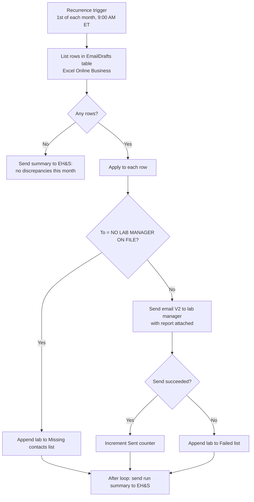

# Power Automate Flow Design: Monthly Inventory Reminders

**Status:** Designed, not built. Building it requires a Microsoft work or school account with Power Automate, which I do not have. This document is the build specification.

**Purpose:** Every month, send each lab manager their chemical inventory discrepancy reminder automatically, and alert EH&S when a lab has no manager on file, so no lab is silently skipped.

**Input:** The `EmailDrafts` table produced by the `RunMonthlyCycle` VBA macro in `inventory_reconciliation.xlsm` (columns: LabID, To, Subject, Body, Issues).

## Flow diagram

## Steps

| # | Step | Connector and action | Settings |
| --- | --- | --- | --- |
| 1 | Trigger | Schedule: **Recurrence** | Frequency Month, interval 1, on day 1 at 9:00 AM, time zone Eastern |
| 2 | Initialize variables | Variables: **Initialize variable** (x3) | `SentCount` (Integer, 0), `MissingContacts` (Array), `FailedSends` (Array) |
| 3 | Read drafts | Excel Online (Business): **List rows present in a table** | Location: OneDrive or SharePoint copy of the workbook; Table: `EmailDrafts` |
| 4 | Empty check | Control: **Condition** | `length(body('List_rows')?['value'])` equals 0 |
| 5 | Loop | Control: **Apply to each** | Over the rows from step 3; concurrency 1 to keep order and avoid throttling |
| 6 | Contact check | Control: **Condition** | `To` is equal to `NO LAB MANAGER ON FILE` |
| 7a | No manager | Variables: **Append to array variable** | Append `LabID` to `MissingContacts` |
| 7b | Get report | OneDrive or SharePoint: **Get file content using path** | `/reports/Lab_@{items('Apply_to_each')?['LabID']}_discrepancies.xlsx` |
| 8 | Send | Office 365 Outlook: **Send an email (V2)** | To, Subject, Body from the row; attach the report from 7b |
| 9 | Handle result | **Increment variable** `SentCount`; on failure, append LabID to `FailedSends` | Failure path uses **Configure run after: has failed** |
| 10 | Summary | Office 365 Outlook: **Send an email (V2)** to the EH&S data inbox | Body: sent count, labs missing a manager, labs where sending failed |

## Error handling

- **Missing manager:** never skipped silently. Collected and listed in the summary email so someone updates the contact record. This is the gap the Lab Contact Confirmation survey exists to close.
- **Failed send:** step 9 runs on failure, records the lab, and lets the loop continue, so one bad address does not stop every other reminder.
- **Missing report file:** step 7b fails, which routes that lab to `FailedSends`.
- **Stale data:** the flow only sends what the workbook contains. The macro must run before the 1st; a later version would check the workbook's modified date and alert if it is older than 7 days.

## Security and governance

- Run under a shared EH&S service account, not a personal account, so the flow survives staff changes.
- Give that account read access only to the workbook and reports folder (least privilege).
- Store the workbook in a SharePoint site restricted to the EH&S data team.
- Keep a human in the loop for content: the macro drafts, a person reviews the EmailDrafts sheet, then the flow sends.

## Test plan

1. Point every **To** at my own address and run the flow manually.
2. Confirm one email per lab with the correct attachment, and none for labs without discrepancies.
3. Blank one lab's manager and confirm it appears in the summary under missing contacts.
4. Use a malformed address for one lab and confirm the loop continues and the failure is reported.
5. Check the run history for each step's inputs and outputs.

## Alternatives without Power Automate

- **VBA + classic Outlook:** the macro can create drafts directly with `.Display` (already prototyped in Step 6.5), but needs classic desktop Outlook and a person to run it.
- **Windows Task Scheduler + Python:** possible, but it moves automation outside the Microsoft 365 tools EH&S already uses, so Power Automate is the better fit.
